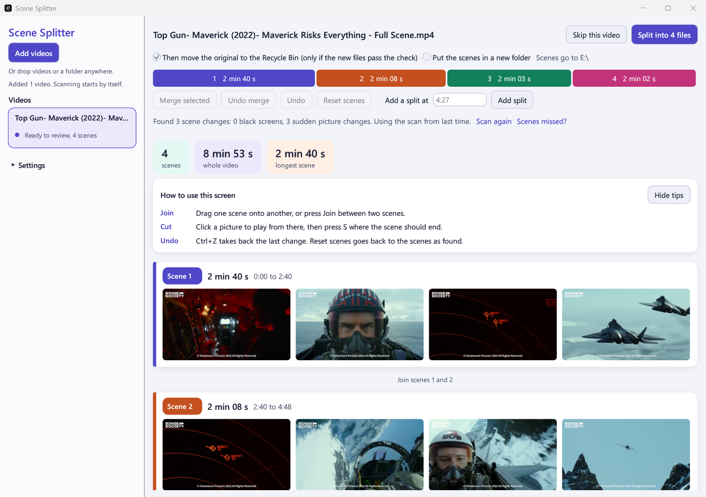
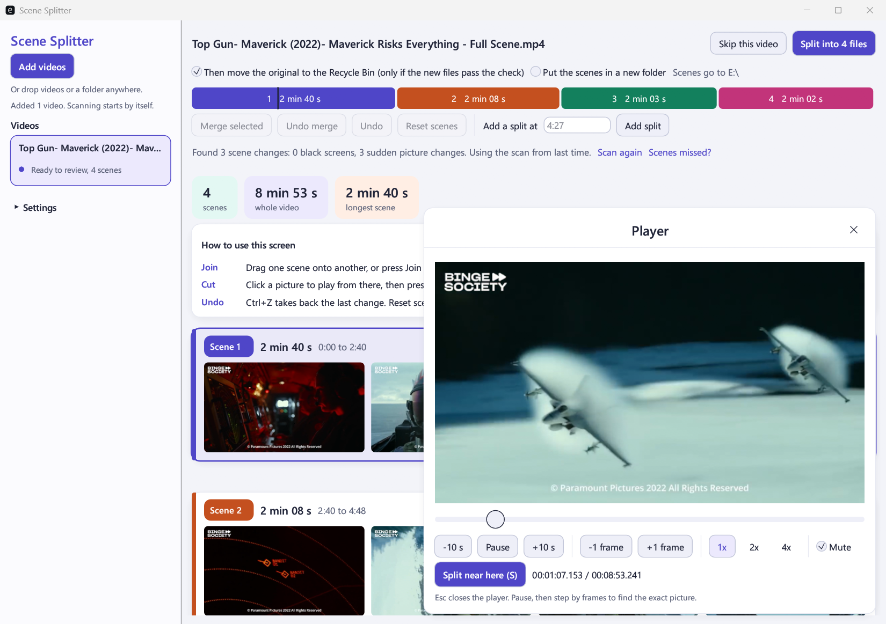

# Scene Splitter

[](https://github.com/algometrix/scene_splitter/actions/workflows/ci.yml)


Scene Splitter cuts a long video into its scenes. It finds the stretches of black screen between scenes, shows the proposed scenes in a review screen, and writes one file per scene. It copies the compressed streams and re-encodes nothing, so a split takes seconds and loses no quality.

It is a desktop app and a command line tool in one program, written in Rust with egui/eframe. It runs `ffmpeg` and `ffprobe` for all video work, and downloads them itself the first time it needs them.



## Quick start

You need a Rust toolchain (1.88 or newer). On Linux, install the [build packages](#requirements) first.

```
git clone https://github.com/algometrix/scene_splitter
cd scene_splitter
cargo run --release
```

1. Drop a video onto the window, or press "Add videos" (Ctrl+O). The app scans it for black screens.
2. Review the proposed scenes. Drag one scene card onto another to merge them.
3. Press "Split into N files".

By default the original video moves to the Recycle Bin or Trash once the scene files pass verification. The first time a split would do that, the app explains it and asks. Untick that option on the review screen to keep the original.

## Contents

- [What it does](#what-it-does)
- [Requirements](#requirements)
- [Build and run](#build-and-run)
- [Using the window](#using-the-window)
- [Command line](#command-line)
- [Settings](#settings)
- [ffmpeg](#ffmpeg)
- [Where files are kept](#where-files-are-kept)
- [How it works](#how-it-works)
- [Platforms](#platforms)
- [Limitations](#limitations)
- [Running the tests](#running-the-tests)
- [Bugs and feature requests](#bugs-and-feature-requests)
- [License](#license)

## What it does

- **Fast scan.** A two hour 480p video is scanned in about two seconds, because black frames show up in the packet sizes before anything is decoded.
- **Hard cuts.** An optional slower scan finds scene changes that have no black screen.
- **Review before writing.** Merge scenes by dragging, add a split by time, move a split to the next point where the video can be cut, move a part back out of a merged scene, undo, or reset.
- **Review without the mouse.** Every step of a review has a key, and the window lists them.
- **Built-in player.** Click a preview picture to play from there, step frame by frame with the mouse wheel, and split the scene at the current position.
- **Verified before the original is removed.** After a split, the app checks every packet of the scene files against the original. Only then does it move the original to the Recycle Bin or Trash.
- **Scan ahead.** Scan a whole folder from the command line, and review the results in the window later.
- **No ffmpeg setup.** The app fetches ffmpeg on first run and checks it against a built-in checksum.



## Requirements

- A Rust toolchain, version 1.88 or newer, with Cargo.
- Windows, macOS or Linux. See [Platforms](#platforms) for what has been tested.
- On Linux, a few packages to build it (Debian and Ubuntu names):

  ```
  sudo apt install pkg-config libasound2-dev libxkbcommon-dev libwayland-dev
  ```

You do not need to install ffmpeg. See [ffmpeg](#ffmpeg).

## Build and run

```
cargo build --release
```

Cargo writes the program to `target/release/scene_splitter` (`target\release\scene_splitter.exe` on Windows). Run it with no arguments to open the window:

```
target/release/scene_splitter
```

You can also run it through Cargo: `cargo run --release -- <arguments>`.

## Using the window

1. Drop videos or a folder onto the window. Or press "Add videos" in the left panel (Ctrl+O) to choose videos or a folder with the system's file picker, or to paste a path. A folder queues every video directly inside it. Subfolders are not searched, and scene files from an earlier split are left out.
2. The app scans the queued videos in the background, one at a time. The queue on the left shows the state of each video. The video being scanned shows a progress bar with a percentage, in the queue and on its own page.
3. When a scan finishes, the video is ready for review. Each scene is a colour-coded card with preview pictures. A timeline above the cards shows the whole video with one block per scene. Point at a block to see the scene's number and times, and click it to jump to that scene's card. A block shows its scene number, and the scene's length, when there is room for them. A scene longer than 45 minutes is marked in red, as a hint that a scene change may have been missed.
4. Edit the scenes:
   - Drag a scene card onto another to merge them and everything between. The small "Join scenes N and N+1" button between two cards merges just those two.
   - Click, Ctrl-click or Shift-click cards to select several, then press M or "Merge selected". A selection with gaps merges the scenes between as well.
   - "Undo merge" takes the selected merged scenes apart again. Inside a merged scene, "Separate here" restores a single split, and "Move out to its own scene" takes one part out of it.
   - A merged scene with more than 6 parts shows its first two and last two. "Show all N parts" shows the rest, and "Show fewer parts" hides them again. The app remembers this for each scene while the review is open.
   - "Add a split at" takes a time such as `1:03:12`. The split lands on the nearest point where the video can be cut (a keyframe).
   - "Move split earlier" and "Move split later", at the two ends of the row between two cards, move the split between those scenes to the next point where the video can be cut. The line under the toolbar says the old and the new time. A split does not move onto or past the split beside it, into the parts of a merged scene, or to the ends of the video. The app says which of these stopped it.
   - Undo takes back the last change, a moved split included. "Reset scenes" returns to the scenes as found, and puts moved splits back.
5. If the video has scene changes with no black screen, press "Scenes missed?" under the toolbar. Choose how much to detect (only obvious changes, most changes, or even subtle changes) and the shortest scene to allow, then press "Look for sudden picture changes". This scan looks at every picture and is much slower.
6. Under the video's name, choose whether the original is moved to the Recycle Bin or Trash and whether the scenes go in a new folder. Then press "Split into N files". The first time a split would move an original to the Recycle Bin or Trash, the app says what will happen and that it only happens if the new files pass the check. Choose "Move it to the Recycle Bin" (or Trash), "Keep the original", or cancel. The app remembers that you answered and does not ask again. If scene files from an earlier split are in the way, the app asks before it replaces them. "Skip this video" writes nothing, and a skipped video can be taken up again.
7. When the split is done, the app shows whether the check passed and what happened to the original. "Open folder" shows the scene files.

When something goes wrong, the app says so in plain words and shows the technical reason under it. You can select that text, and "Copy details" puts all of it on the clipboard.

If the scan could not read a stretch of the video, a note above the scenes says where, because a scene change there may have been missed.

The first time, a "How to use this screen" card sits above the scenes with three tips. "Hide tips" removes it, and Settings or "Show tips" brings it back. A scan or rescan asks first if it would throw away merges or splits you made.

The window can be made as small as 900 by 600. Below the name and the toolbar, everything scrolls with the scenes. Only the scene cards in view are drawn, to keep a long list of scenes quick to scroll.

On a high-resolution screen the preview pictures and the player's picture are decoded larger, so they stay sharp.

Scene files are named `<video name>_scene_001`, `_scene_002` and so on, with the extension of the original.

"Scan again" ignores the stored scan of the video and looks for black screens afresh. What an earlier look for sudden picture changes found in the same file is kept.

### Review keys

A review can be done without the mouse. The keys work on one scene at a time, which has a dark frame around its card. Click a card or press an arrow key to put the frame on a scene. The list scrolls to keep that scene in view.

On macOS, use Cmd where this page says Ctrl.

| Key | Action |
| --- | --- |
| Up, Down | Go to the scene above or below, and select it |
| Home, End | Go to the first or the last scene |
| Shift+Up, Shift+Down (also with Home and End) | Select more scenes, or fewer |
| Enter or Space | Play the scene from its start |
| Left, Right | Choose a picture of the scene, which gets a frame too. Enter or Space then plays from that picture |
| J | Join the scene with the one below it |
| M | Merge the selected scenes |
| U | Take a merged scene apart again (the selected scenes or, with none selected, the scene with the frame) |
| Alt+Left, Alt+Right | Move the split at the start of the scene to the point before or after it where the video can be cut |
| Ctrl+Enter | Split into files. The same questions are asked as after the button |
| Ctrl+O | Add videos |
| Ctrl+A | Select every scene |
| Ctrl+Z | Undo the last change |
| Esc | Clear the selection (when the player is open, it closes the player first) |
| F1 | Show or hide the list of keys |
| Tab, Shift+Tab | Go through the buttons and boxes. Space or Enter presses the one that is marked, and Esc gives the keys back to the scenes |

"Keys" on the line under the toolbar, "Show keys" on the tips card, and F1 show this list in the window, above the scenes.

While the player is open, Space and the plain Left and Right keys are the player's. Enter still plays the scene with the frame, and the other review keys work as before. While you type in a box, the keys are text.

### The player

Click a preview picture to play the video from that moment. A line on the timeline shows where the player is. The player starts muted, and asks before it turns the sound on. The question appears in front of the player with the rest of the window dimmed. Esc, or a click outside it, keeps the sound off and leaves the player open.

| Key or control | Action |
| --- | --- |
| A or Left arrow | Go back 10 seconds |
| D or Right arrow | Go forward 10 seconds (with Alt held, the arrow keys move a split in the review instead) |
| Space | Pause or play |
| S | Split the scene at the current position |
| Mouse wheel over the picture, or the "-1 frame" and "+1 frame" buttons | Pause and step one frame (wheel down is forward) |
| Position slider | Jump to any moment |
| 1x, 2x, 4x buttons | Playback speed |
| Mute box | Sound off or on |
| Esc | Close the player, or cancel the question about sound |

A split made in the player lands on the nearest point where the video can be cut (a keyframe). Once you pause, the player says how far that point is from the picture you are on. Skipping or dragging the slider while paused stays paused. The player sizes itself to fit the window.

## Command line

| Command | What it does |
| --- | --- |
| `scene_splitter` | Opens the window. |
| `scene_splitter <folder>` | Opens the window with every video directly inside the folder queued. |
| `scene_splitter <video>` | Scans the video and splits it at once, with no review. |
| `scene_splitter <video> --review` | Opens that video in the window instead of splitting it at once. |
| `scene_splitter <video> --list-only` | Prints the black screens and scenes. Writes no scene files. |
| `scene_splitter <video or folder> --scan-only` | Scans the video, or every video directly inside the folder, and stores the results in the cache. Writes nothing else. |

Splitting from the command line always scans the video afresh. Only the window and `--scan-only` read the cache. If the scan finds no scene changes, nothing is written.

| Option | Meaning |
| --- | --- |
| `--out-dir <folder>` | Where to write the scene files. The default is the saved setting: the video's own folder, unless you changed it. |
| `--overwrite` | Replace scene files left in the output folder by an earlier run. Without it, the split stops if such files exist. |
| `--keep-original` | Keep the original video, whatever the saved setting says. |
| `--hard-cuts` | Also look for hard cuts (scene changes with no black screen). This decodes every frame and is much slower. It uses the saved sensitivity and shortest scene. |
| `--scan suspicious` | Decode only where packet sizes hint at a black screen. |
| `--scan every-frame` | Decode every frame. Use it when the black screens are noisy or grainy. |
| `--min-black <seconds>` | Shortest black screen that counts as a scene change. |
| `--max-luma <0 to 255>` | Brightest pixel value that still counts as black. |
| `--black-fraction <0 to 1>` | Share of a frame's pixels that must be black. |
| `--help`, `--version` | Print the help text or the version. |

Options you leave out take their value from the saved [settings](#settings). Out of the box these are `--scan suspicious`, `--min-black 0.25`, `--max-luma 32` and `--black-fraction 0.98`.

A command line split exits with an error code when the scenes could not be verified or the original could not be moved, so a script can tell.

Which options work together:

- `--scan-only` cannot be combined with `--review`, `--list-only`, `--out-dir`, `--overwrite` or `--keep-original`.
- `--review` cannot be combined with `--list-only`, `--out-dir`, `--overwrite` or `--keep-original`.
- `--list-only` cannot be combined with `--keep-original`.
- `--hard-cuts` works with every command. With `--review` or a folder, the window opens with the hard-cut scan already chosen for the queued videos.
- The detection options (`--scan`, `--min-black`, `--max-luma`, `--black-fraction`) and `--keep-original` apply to a command line run. The app refuses them when the command opens the window, where the Settings section does that job.
- A folder without `--scan-only` opens the window. The app refuses `--list-only`, `--out-dir` and `--overwrite` with a folder, since they work on a single video.

### Scanning ahead of time

`--scan-only` scans a batch of videos without the window open, for example overnight:

```
scene_splitter D:\videos --scan-only
scene_splitter D:\videos --scan-only --hard-cuts
```

The second form also runs the slow hard-cut pass. When you later open the same videos in the window, they are ready for review at once, and "Look for sudden picture changes" returns without another slow scan.

The window reuses a stored scan only if its detection settings match the ones the scan was made with. If you pass detection options to `--scan-only`, set the same values in the window.

## Settings

The Settings section is at the bottom of the left panel. It holds:

- Whether the original is moved to the Recycle Bin or Trash after the check.
- Whether scenes are written beside the video or in a new `<video name>_scenes` folder next to it.
- Whether the tips are shown on the review screen.
- For missed scenes: how much to detect, and the shortest scene to allow.
- Under "Advanced: what counts as a black screen": the shortest black screen, how dark counts as black, how much of the picture must be black, and "Check every picture", the slow scan for grainy black screens.
- "Restore default settings". This leaves your choice about originals as it is, and does not bring back the one-time question about the Recycle Bin or Trash.

If the settings could not be loaded or saved, the reason is shown at the top of the section, with "Copy details".

The app saves settings as you change them, to `scene_splitter/settings.json` in the settings folder (see [Where files are kept](#where-files-are-kept)). Changed detection settings apply to videos scanned from then on. The window and the command line share the file.

Command line options override the saved settings for that run and are never saved.

If the settings file cannot be read, the app says so, uses the defaults, and keeps originals until you save settings again. It does not fall back to recycling them.

The review screen shows a short "How to use this screen" card. "Hide tips" removes it, and the Settings section brings it back.

## ffmpeg

The app needs `ffmpeg` and `ffprobe`. It looks for them in this order:

1. Its own copy, in `scene_splitter/tools/ffmpeg-6.1.1` inside the data folder (see [Where files are kept](#where-files-are-kept)).
2. Your `PATH`.
3. If neither has both programs, it downloads ffmpeg 6.1.1 into the folder from step 1. This happens once. The window shows a progress bar, and the command line prints the progress. You can queue videos while it downloads. If the download fails, the window offers "Try again".

The downloads are the static builds from the `b6.1.1` release of the [`ffmpeg-static`](https://github.com/eugeneware/ffmpeg-static) project on GitHub, two gzipped files per system:

| System | Download size |
| --- | --- |
| Windows x64 | about 56 MB |
| macOS, Apple Silicon | about 37 MB |
| macOS, Intel | about 48 MB |
| Linux x64 | about 56 MB |
| Linux ARM64 | about 49 MB |

The app checks each file against a SHA-256 checksum built into the program and discards it on a mismatch. On any other system (Windows on ARM, for example), or to use your own ffmpeg, put `ffmpeg` and `ffprobe` on your `PATH`.

ffmpeg is a separate project with its own license (these builds are GPL). It is not part of this repository.

## Where files are kept

| System | Data folder | Settings folder | Temp folder |
| --- | --- | --- | --- |
| Windows | `%LOCALAPPDATA%` | `%APPDATA%` | `%TEMP%` |
| macOS | `~/Library/Application Support` | `~/Library/Application Support` | `$TMPDIR` |
| Linux | `$XDG_DATA_HOME` or `~/.local/share` | `$XDG_CONFIG_HOME` or `~/.config` | `$TMPDIR` or `/tmp` |

Inside each, the app uses a `scene_splitter` folder:

- Data folder: `scene_splitter/tools/ffmpeg-6.1.1`, the downloaded ffmpeg.
- Settings folder: `scene_splitter/settings.json`.
- Temp folder: `scene_splitter/scans`, the scan cache.

## How it works

**Packet-size prefilter.** A black frame compresses to almost nothing (about 25 bytes, against several kilobytes for a normal frame). `ffprobe` reads the packet table without decoding, which takes about a second even for a long file. The app then decodes only the stretches with tiny packets, as small grey thumbnails, to confirm which frames are really black. This is why the normal scan is fast. Grainy or noisy black screens do not compress this small, so `--scan every-frame` (or "Decode every frame" in the settings) decodes the whole video instead.

**Hard cuts.** The hard-cut scan decodes every frame and compares it with the frame before. A hard cut is a single frame that differs sharply from its predecessor while its neighbours barely change. Films cut between camera angles every few seconds, so the app keeps the strongest changes and drops the rest until every scene is at least as long as the shortest scene you set.

**Keyframe cuts.** The split copies the compressed streams, and a copy can only start a file on a keyframe, because every other frame depends on the frames before it. Each cut goes on the keyframe nearest to its black screen. A keyframe inside the black screen gives a clean cut. Otherwise the cut lands slightly before or after it, and one scene keeps a moment of its neighbour.

**Nothing half-written.** The split writes the scenes into a folder named `unfinished_` and a number, inside the folder they go to. Only when every scene is there does it move them to their names and remove that folder. A split that fails or stalls leaves no partial scene files, and leaves the scene files of an earlier split as they were. In the window, a video whose split failed offers "Back to review", which brings back the scenes as you left them, and "Try again", which scans it afresh.

**Verification before recycling.** After the split, the app checks three things:

1. The original holds no stream that the scenes do not carry (see [Limitations](#limitations)).
2. The scene files, joined in order, hold exactly the original's video and audio packets. The app compares the size and checksum of every packet.
3. Each scene opens and its first 2 seconds decode without error.

Only when all three pass does the original go to the Recycle Bin (the Trash on macOS and Linux). If verification or the move fails, the original stays where it is and the report says why. Recycling is the default. Turn it off with `--keep-original`, on the review screen, or in the settings.

**Cache.** The app stores each scan as a JSON file in the scan cache. It reuses a stored scan only when the video's path, size, modified time and the detection settings all match. The stored hard-cut data lets you change sensitivity and shortest scene later without another slow scan. If the system clears the temp folder, the only cost is a rescan.

## Platforms

The code is written for Windows, macOS and Linux. The window has only been used by hand on Windows. The tests, including the end-to-end ones, run on Linux, and the CI workflow is set up to lint and test on all three systems. On macOS and Linux, treat the window, the player's sound and the move to the Trash as untested until you have tried them.

What differs between systems:

- The original goes to the Recycle Bin on Windows and to the Trash on macOS and Linux.
- The window borrows a system font: Segoe UI on Windows, Arial on macOS, DejaVu Sans on Linux. Without it, the toolkit's built-in font is used.
- macOS may refuse to run a downloaded program it has not seen before. If ffmpeg fails to start there, install it with Homebrew (`brew install ffmpeg`) so it is on your `PATH`.

## Limitations

- Cuts land on keyframes. A cut can be up to half the distance between two keyframes away from the moment you chose.
- The hard-cut scan finds shot changes, not story scenes. Expect to merge its results by hand.
- Audio and video sync in the player is loose. The player is for finding scene boundaries, not for watching.
- Scene files contain the first video stream and the audio streams. Other streams, such as subtitles or cover art, are not copied. An original that holds such streams fails verification on purpose, so it is never recycled.
- The window has been run by hand on Windows only. See [Platforms](#platforms).

## Running the tests

```
cargo test --release
```

This runs the unit tests, which need neither ffmpeg nor a display. They include tests that drive the real review screen with simulated mouse and keyboard input.

The end-to-end tests are ignored by default because they need `ffmpeg` and `ffprobe` on your `PATH` (the copy the app downloads does not count). They generate a small video from test patterns, then scan, split, verify and play it for real:

```
cargo test --release -- --include-ignored
```

The CI workflow runs this second command on Windows, macOS and Linux, after a formatting check and Clippy.

## Bugs and feature requests

To report a bug or request a feature, [open an issue](https://github.com/algometrix/scene_splitter/issues). For a bug, include your operating system, the command or steps you used, and what the app printed or showed. Do not attach or name private videos.

## License

No license has been chosen yet.
