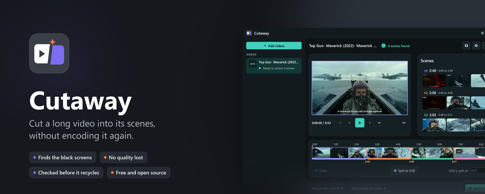
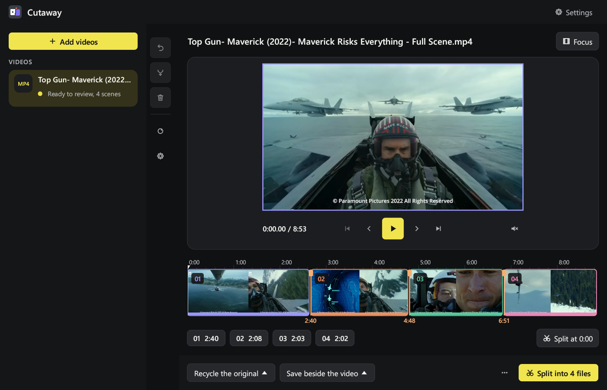
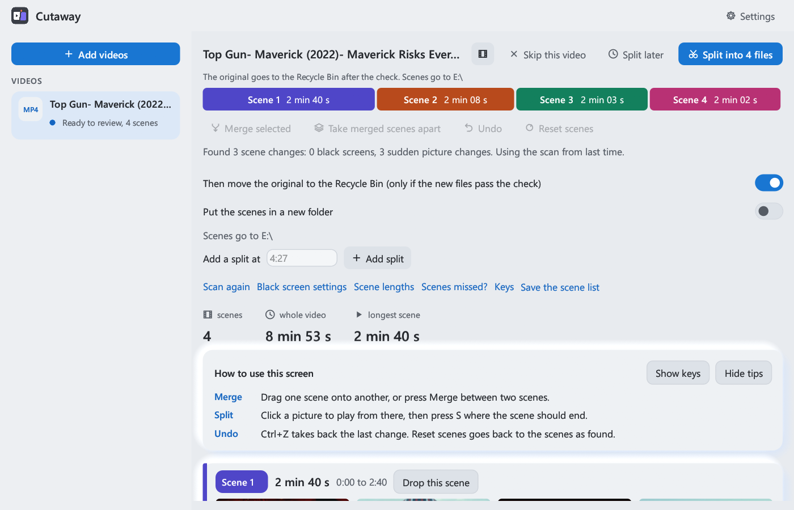
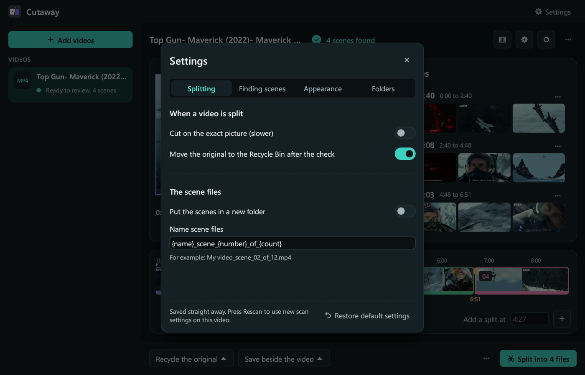
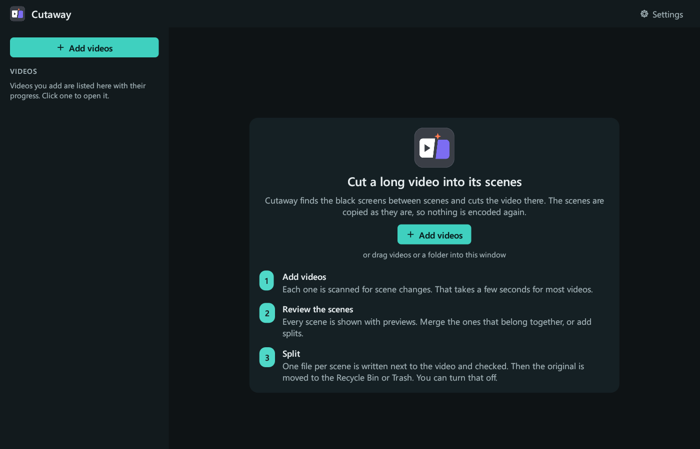
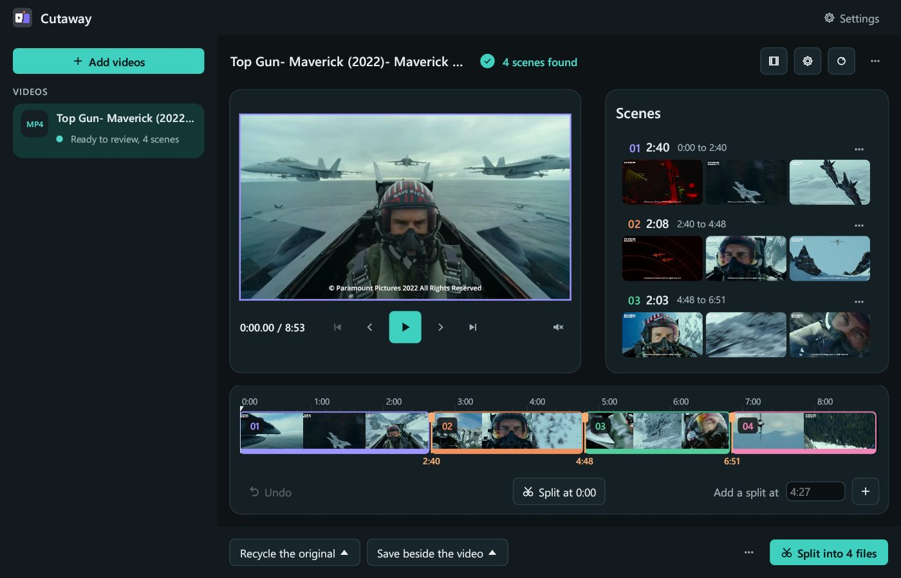
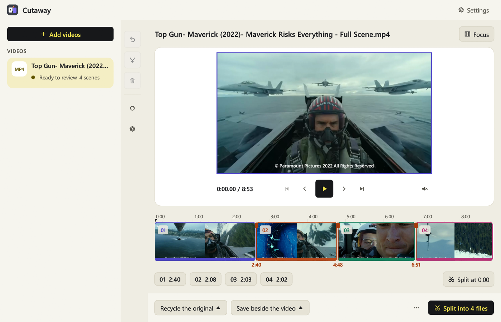
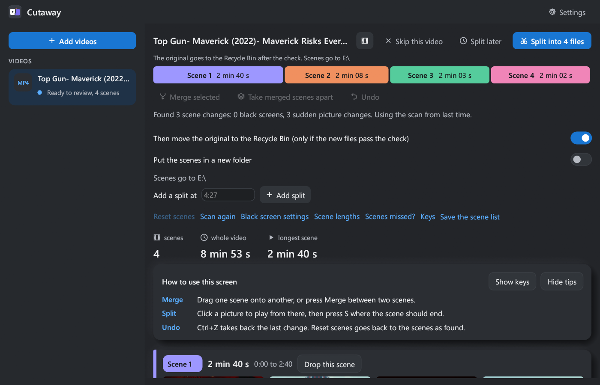
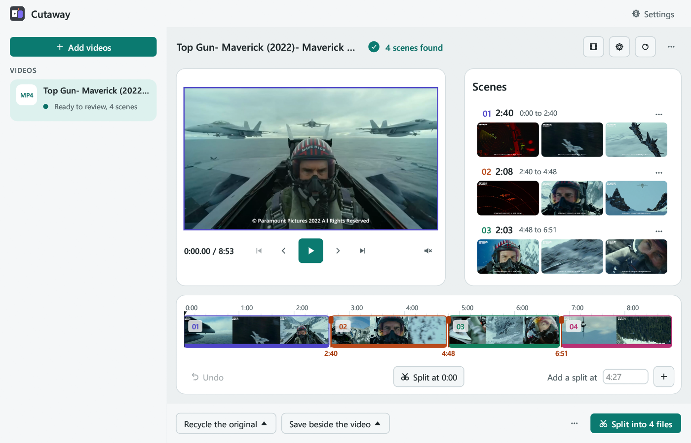

<a id="top"></a>

<p align="center">
  <picture>
    <source media="(prefers-color-scheme: dark)" srcset="docs/banner-dark.png">
    <source media="(prefers-color-scheme: light)" srcset="docs/banner-light.png">
    
  </picture>
</p>

<p align="center">
  <a href="https://github.com/algometrix/scene_splitter/releases/latest"></a>
</p>

<p align="center">
  <a href="https://github.com/algometrix/scene_splitter/releases/latest"></a>
  <a href="https://github.com/algometrix/scene_splitter/releases"></a>
  <a href="https://github.com/algometrix/scene_splitter/actions/workflows/ci.yml"></a>
  <a href="#-license"></a>
  
  
  <a href="https://github.com/algometrix/scene_splitter/stargazers"></a>
</p>

<p align="center">
  <a href="#-features"><b>Features</b></a> •
  <a href="#-install"><b>Install</b></a> •
  <a href="#-how-to-use"><b>How to use</b></a> •
  <a href="#-command-line"><b>Command line</b></a> •
  <a href="#-faq"><b>FAQ</b></a> •
  <a href="docs/guide.md"><b>Guide</b></a> •
  <a href="https://github.com/algometrix/scene_splitter/issues/new/choose"><b>Report a bug</b></a>
</p>

<br>

<table>
  <tr>
    <td width="33%" valign="top">
      <h3>🎬 Finds the scenes</h3>
      Spots the black screens between scenes in seconds, and can look for sudden picture changes too.
    </td>
    <td width="33%" valign="top">
      <h3>✂️ No quality lost</h3>
      Copies the video as it is, nothing encoded again, so a split takes seconds.
    </td>
    <td width="33%" valign="top">
      <h3>🛡️ Checked first</h3>
      Reads every scene file to its end before the original goes to the Recycle Bin.
    </td>
  </tr>
</table>

## 🎞️ See it in action

<p align="center">
  
</p>

## ✨ Features

<table>
  <tr>
    <td width="50%" valign="top">

**🔎 Finding scenes**

- **Fast scan.** Black frames show up in the packet sizes before anything is
  decoded, so a long video is scanned in a couple of seconds.
- **Sudden picture changes.** An optional slower scan finds scene changes
  with no black screen between them.
- **Chapter marks.** Each chapter start is offered as a split, and the scene
  keeps the chapter's title.
- **Scene length limits.** Set a shortest and a longest scene.
- **Scan settings per folder**, for videos from a source that needs them.
- **Scan ahead** a whole folder from the command line, overnight.

**🖐️ Reviewing**

- **See every scene** on a film strip timeline with preview pictures.
- **Merge, split, move a split, drop a scene, undo**, with the mouse or the keys.
- **A built-in player** that steps picture by picture.
- **Review now, split later**: press **Split later** on each video, then
  split all the ready videos at once.

</td>
    <td width="50%" valign="top">

**💾 Splitting**

- **Copies the streams.** A split takes seconds and loses nothing.
- **Exact cuts, if you want them.** Only the few seconds around each cut are
  encoded again.
- **Nothing half-written.** Scenes appear only when every one is complete.
- **Checked before the original is moved**, and only ever to the Recycle Bin
  or Trash.
- **Your own file names**, with `{name}`, `{number}`, `{count}` and more.
- **A scene list without splitting**: CSV, ffmpeg chapters, or an EDL.

**🎨 Made to be used**

- **Three styles**: Editor, Studio and Soft, each light and dark.
- **The main actions have keys**, listed under **Keys** in Editor and Soft.
- **No ffmpeg setup.** It downloads a checksummed copy the first time.
- **Plain words** when something goes wrong, with the details to copy.

</td>
  </tr>
  <tr>
    <td colspan="2" valign="top">

**🪶 Small and private**: one program, nothing to install • no account, no ads, no telemetry • your videos never leave your computer • works at 900 by 600 • sharp on high-DPI screens • Windows, macOS and Linux

</td>
  </tr>
</table>

<p align="center">
  
  
</p>
<p align="center">
  
  
</p>

<p align="right"><a href="#top">Back to top ↑</a></p>

## 📦 Install

Download the package for your system from the
[**latest release**](https://github.com/algometrix/scene_splitter/releases/latest),
unpack it, and start `scene_splitter`. There is nothing to install, and you do
not need ffmpeg: Cutaway downloads it the first time it runs.

| | Package | For |
| --- | --- | --- |
| 🪟 | `scene_splitter-<version>-windows-x86_64.zip` | Windows 10 and 11, 64-bit |
| 🍎 | `scene_splitter-<version>-macos-arm64.tar.gz` | Macs with Apple silicon |
| 🍎 | `scene_splitter-<version>-macos-x86_64.tar.gz` | Macs with an Intel processor |
| 🐧 | `scene_splitter-<version>-linux-x86_64.tar.gz` | Linux, 64-bit |
| 🔒 | `SHA256SUMS.txt` | Checksums of every package |

> [!NOTE]
> The programs are not signed. Windows may say **"Windows protected your
> PC"**: click **More info**, then **Run anyway**. On macOS, run
> `xattr -d com.apple.quarantine scene_splitter` once in the unpacked folder.

<details>
<summary><b>Check a download against its checksum</b></summary>
<br>

Put `SHA256SUMS.txt` next to the package and run:

```sh
sha256sum --ignore-missing -c SHA256SUMS.txt        # Linux
shasum -a 256 --ignore-missing -c SHA256SUMS.txt    # macOS
```

On Windows, compare the result of this with the line for your package:

```powershell
Get-FileHash .\scene_splitter-<version>-windows-x86_64.zip -Algorithm SHA256
```

</details>

<p align="right"><a href="#top">Back to top ↑</a></p>

## 🚀 How to use

1. **Add videos.** Drag videos or a folder into the window, or press
   **Add videos** (<kbd>Ctrl</kbd>+<kbd>O</kbd>). Each one is scanned in the
   background.
2. **Review the scenes.** Click a video in the list. Merge scenes that belong
   together, add a split where the player is with <kbd>S</kbd>, and drop scenes you do not want written, such as adverts.
3. **Split.** Press **Split into N files**. One file per scene is written
   next to the video and checked.

> [!IMPORTANT]
> By default the original then goes to the Recycle Bin or Trash, once the
> scene files pass the check. The first time, Cutaway asks. To keep it, choose
> **Keep the original** beside the split button (untick the box in Soft), or
> turn recycling off in
> **Settings**. A split with dropped scenes or exact cuts always keeps it.

**Pick a style** in **Settings > Appearance**:

| Editor | Studio | Soft |
| --- | --- | --- |
|  |  |  |
| The player beside a list of scenes, a film strip under both. | The picture as large as it gets, the tools down the left. | Coloured scene bars and a list of scene cards. |

**Keys of the review screen** (on macOS, Cmd where this says Ctrl)

| Scenes | | Changes | |
| --- | --- | --- | --- |
| Next or previous scene | <kbd>↓</kbd> / <kbd>↑</kbd> | Merge the selected scenes | <kbd>M</kbd> |
| Select more or fewer | <kbd>Shift</kbd>+<kbd>↓</kbd> / <kbd>↑</kbd> | Merge with the scene above | <kbd>J</kbd> |
| Play the scene | <kbd>Enter</kbd> | Take a merged scene apart | <kbd>U</kbd> |
| Split where the player is | <kbd>S</kbd> | Drop or keep the scene | <kbd>X</kbd> |
| Show only the picture (Focus) | <kbd>F</kbd> | Move a split earlier or later | <kbd>Alt</kbd>+<kbd>←</kbd> / <kbd>→</kbd> |
| Select every scene | <kbd>Ctrl</kbd>+<kbd>A</kbd> | Undo | <kbd>Ctrl</kbd>+<kbd>Z</kbd> |
| Select no scene | <kbd>Esc</kbd> | Split into files | <kbd>Ctrl</kbd>+<kbd>Enter</kbd> |

The [guide](docs/guide.md) explains every screen, setting and safeguard.

<details>
<summary><b>More screenshots</b></summary>
<br>

| Editor, light | Studio, dark |
| --- | --- |
|  |  |

</details>

<p align="right"><a href="#top">Back to top ↑</a></p>

## 💻 Command line

The same program is a command line tool.

```sh
# List the scenes of a video without writing anything
scene_splitter film.mp4 --list-only

# Split at once, keeping the original, and look for hard cuts too
scene_splitter film.mp4 --keep-original --hard-cuts

# Save the scenes as a table, without splitting
scene_splitter film.mp4 --list-only --save-list film.csv

# Scan a whole folder now, and review it in the window later
scene_splitter D:\videos --scan-only
```

Run `scene_splitter --help` for every option, or read
[Command line](docs/guide.md#command-line) in the guide.

## ❓ FAQ

<details>
<summary><b>Is it free?</b></summary>
<br>
Yes. Cutaway is free and open source under the MIT or Apache 2.0 license,
with no ads and no paid version.
</details>

<details>
<summary><b>Why is a cut a little off the moment I chose?</b></summary>
<br>
A copied video can only be cut at certain points (keyframes), so each split
goes to the nearest one. Turn on <b>Cut on the exact picture (slower)</b> in Settings to cut on the very
picture: only the few seconds around each cut are encoded again, and the
original is always kept.
</details>

<details>
<summary><b>My video has no black screens. Can it still be split?</b></summary>
<br>
Yes. Choose <b>Scenes missed?</b> on the review screen in Editor or Soft (or
<code>--hard-cuts</code>) to look for sudden picture changes. This scan looks
at every picture, so it is slower. You can also add splits by hand.
</details>

<details>
<summary><b>Could it lose my video?</b></summary>
<br>
It is built not to. Scenes are written to a temporary folder and only named
when every one is complete. Each scene file is read to its end before the
original is touched, and the original only ever goes to the Recycle Bin or
Trash and is never deleted for good. A split with dropped scenes or exact cuts
always keeps it.
</details>

<details>
<summary><b>Does it send my videos anywhere?</b></summary>
<br>
No. Everything happens on your computer. The only download is ffmpeg, the
first time, from a pinned release checked against a checksum built into the
program.
</details>

<details>
<summary><b>Where are my settings?</b></summary>
<br>
In <code>scene_splitter/settings.json</code> in <code>%APPDATA%</code> on
Windows, <code>~/Library/Application Support</code> on macOS and
<code>~/.config</code> on Linux. See
<a href="docs/guide.md#where-files-are-kept">Where files are kept</a>.
</details>

## 🧹 Uninstall

Delete the unpacked folder. To remove the settings and the downloaded ffmpeg
too, delete the `scene_splitter` folders listed under
[Where files are kept](docs/guide.md#where-files-are-kept). Your videos and
scene files are never touched.

## 🐞 Reporting bugs

Found a bug or have an idea? [Open an issue](https://github.com/algometrix/scene_splitter/issues/new/choose).
The bug form asks for the version, your system, the steps, and what the app
showed. **Copy details** under an error puts all of it on the clipboard.

> [!IMPORTANT]
> Do not attach private videos or name them. A short test video, or a
> description of the footage (black screens, fades, title cards), is enough.

## 🛠️ Building from source

You need Rust 1.88 or newer. On Linux, install the build packages first
(Debian and Ubuntu names):

```sh
sudo apt install pkg-config libasound2-dev libxkbcommon-dev libwayland-dev
```

```sh
git clone https://github.com/algometrix/scene_splitter
cd scene_splitter
cargo run --release
```

<details>
<summary><b>Run the tests</b></summary>
<br>

```sh
cargo test --release                       # unit tests and UI tests, no ffmpeg needed
cargo test --release -- --include-ignored  # also the end-to-end tests, with ffmpeg on PATH
```

The end-to-end tests generate small videos, then scan, split, verify and play
them for real. CI runs them on Windows, macOS and Linux after `cargo fmt` and
Clippy.

</details>

<details>
<summary><b>Project layout</b></summary>
<br>

```text
src/
  timecode.rs, plan.rs, selection.rs   the split plan and its rules, no drawing or files
  black.rs, windows.rs, hardcut.rs     finding black screens and hard cuts
  scenes.rs, scene_length.rs           turning what was found into scenes
  queue.rs, review_session.rs          the list of videos and the changes to a review
  ffmpeg.rs                            the only way ffmpeg and ffprobe are run
  probe.rs, scan.rs, thumbnails.rs     reading the video
  split.rs, verify.rs, export.rs       writing the scenes, checking them, recycling
  exact_split.rs, exact_verify.rs      exact cuts and their check
  tools.rs                             downloads the pinned ffmpeg
  app.rs, review.rs, review/, player.rs, settings_dialog.rs   the window
  theme.rs                             every colour, size and shared widget
scripts/                               the icon, the README banner and tour
```

</details>

## 🗺️ Not supported yet

Joining videos • trimming inside a scene • subtitles and cover art in scene
files • exact cuts for codecs other than H.264 • Windows on ARM without your
own ffmpeg

## ⭐ Star history

<a href="https://star-history.com/#algometrix/scene_splitter&Date">
  <picture>
    <source media="(prefers-color-scheme: dark)" srcset="https://api.star-history.com/svg?repos=algometrix/scene_splitter&type=Date&theme=dark">
    
  </picture>
</a>

## 📄 License

Cutaway is licensed under either of the [Apache License, Version 2.0](LICENSE-APACHE)
or the [MIT license](LICENSE-MIT), at your option. ffmpeg, which it downloads
and runs, is a separate program with its own license (these builds are GPL).

<p align="center">
  
  <br>
  <sub>If Cutaway saves you time, a ⭐ helps others find it.</sub>
</p>

<p align="right"><a href="#top">Back to top ↑</a></p>
